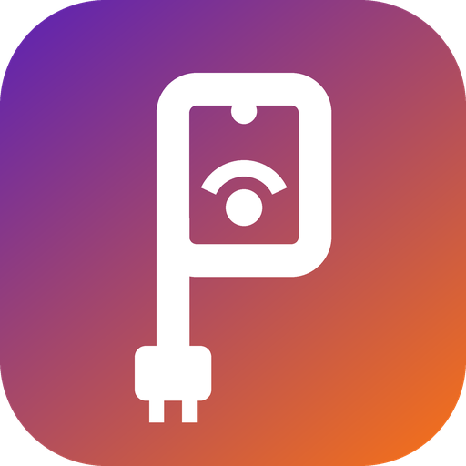

<p align="center"></p>

# PdaNext

Turn your Android phone into a **router for your Windows PC over USB**. The PC gets a real network
adapter, the phone is its gateway (`192.168.42.1`), and everything the PC sends (TCP, UDP, DNS,
ping) goes out through the phone. If a VPN is on in the phone, the whole PC uses that VPN too.
No root, no license.

## How it works

```
 Windows PC                                          Android phone = router
┌───────────────────────────────┐   USB cable     ┌─────────────────────────────────────┐
│ every app, ping, DNS          │  (adb forward)  │ PdaNext app                     │
│            │                  │                 │                                     │
│            ▼                  │   raw IP        │  router 192.168.42.1 (userspace NAT)│
│ "PdaNext" adapter         │   packets       │   TCP  -> phone sockets             │
│ (Wintun) 192.168.42.2/24      │ ──────────────► │   UDP  -> phone sockets             │
│ gateway + DNS 192.168.42.1    │ ◄────────────── │   ping -> phone ICMP socket         │
│ default route, metric 1       │                 │   DNS  -> phone resolver            │
└───────────────────────────────┘                 │            │                        │
                                                  │            ▼                        │
                                                  │  phone network: mobile / Wi-Fi /VPN │
                                                  └─────────────────────────────────────┘
```

- The PC's packets travel unchanged over the USB debugging link. The phone app is a small router:
  it terminates each flow and re-creates it with the phone's own sockets.
- Android routes an app's sockets through an active VPN. So with a VPN on, the phone and the PC
  both reach the internet with the VPN's public IP. Android's built-in USB tethering does the
  opposite: it forwards in the kernel and bypasses the VPN.
- The phone answers pings to `192.168.42.1` itself, pings to the internet go out from the phone,
  and the phone app can ping the PC (`192.168.42.2`).
- DNS goes to the phone (an NRPT rule stops Windows from also asking its other networks), and the
  phone's resolver answers, so DNS follows the VPN too. IPv6 answers are withheld so Windows does
  not send IPv6 out of another network.

Without root, a phone app cannot forward arbitrary IP protocols: TCP, UDP and ping (ICMP echo) are
carried; other protocols (GRE, raw ESP, traceroute's TTL-expired replies) are not.

## Use it

1. **Phone**: install `PdaNext.apk` (the Windows app can also install it over USB).
   Turn on **USB debugging** (Settings > About phone > tap *Build number* 7 times > Developer options).
2. **PC**: run `PdaNext-Setup.msi` from the latest release (Start menu and desktop shortcuts,
   uninstall from *Settings > Apps*). A portable `PdaNext-Windows.zip` is there too.
   The app asks for administrator rights: it creates the network adapter.
3. Plug in the cable, allow the USB debugging prompt on the phone, press **Connect**.

The window shows the phone's uplink and VPN state, traffic, and live pings to the router and to
the internet. Close it to keep running in the tray.

No proxy is configured anywhere on the PC: to Windows and its apps this is an ordinary network
adapter behind a router, and websites see the phone's (or its VPN's) IP address.

## Build and test

| What | Command |
| --- | --- |
| Phone engine unit tests (any OS, JDK 17+) | `gradle -p core test` |
| Windows logic tests (any OS, .NET 8 SDK) | `dotnet run --project windows/tests` |
| End-to-end: a Linux TUN "PC" behind the router: ping, DNS, TCP, UDP, 50 MB, 50 parallel | `gradle -p core installDist && sudo tests/e2e/run-router-e2e.sh` |
| Android APK | `gradle -p android :app:assembleRelease` |
| Windows exe | `dotnet build windows/PdaNext.csproj -c Release` |
| Windows installer (on Windows, WiX 5) | `wix build windows/installer/PdaNext.wxs -arch x64 -ext WixToolset.UI.wixext -ext WixToolset.Util.wixext -d Version=3.0.0 -d SourceDir=<release folder>` |
| Logo and icons | `python3 tools/logo/draw_logo.py` |

CI (`.github/workflows/release.yml`) runs all of these, bundles `adb` and `wintun.dll` next to the
exe, builds the MSI and checks that it installs and uninstalls cleanly, and publishes a release from `main`.

## Layout

```
core/       phone engine, plain Kotlin/JVM: the router (router/) and the status endpoint
android/    Android app: foreground service + UI
windows/    Windows app (C#, .NET Framework 4.8 built into Windows 10/11) and its MSI (installer/)
tools/logo/ the PdaNext logo, drawn in code; regenerates every icon
tests/e2e/  Linux network-namespace test of the whole path
replica/    clean-room recon of PdaNet+
docs/       health check of the previous version
```

## License

MIT. `wintun.dll` is distributed under its own license (bundled as `bin/wintun-LICENSE.txt`).
